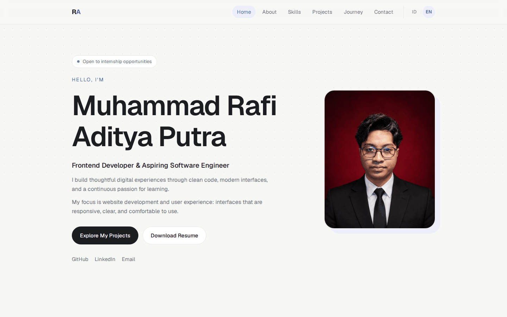
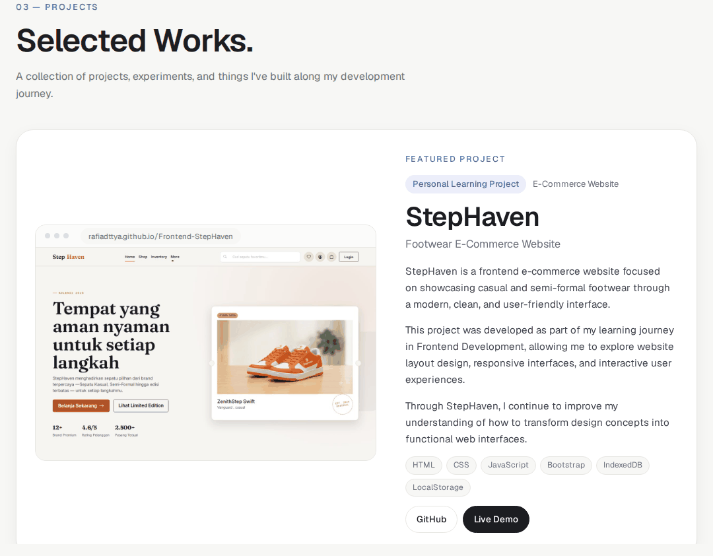

# Portfolio — Muhammad Rafi Aditya Putra

Website portofolio pribadi seorang Frontend Developer. Dibangun dengan HTML, CSS, dan JavaScript murni (tanpa framework dan tanpa proses build), dengan dukungan dua bahasa: Indonesia dan Inggris.





## Fitur

- Desain minimalis dan responsif untuk desktop, tablet, dan HP
- Pengalih bahasa ID / EN langsung tanpa reload, pilihan tersimpan di browser
- Featured project dengan screenshot, tech stack, tautan GitHub, dan Live Demo
- Filter kategori project yang muncul otomatis saat project bertambah
- Form kontak dengan validasi (membuka aplikasi email, tanpa klaim terkirim palsu)
- Animasi halus yang menghormati pengaturan `prefers-reduced-motion`
- Aksesibilitas: HTML semantik, skip link, label ARIA, fokus keyboard yang jelas

## Teknologi

HTML5 · CSS3 (custom properties, grid, flexbox) · JavaScript ES Modules · Devicon

## Menjalankan di komputer

Website harus dibuka lewat server lokal karena file terjemahan dimuat dengan `fetch`.

1. Buka folder proyek di VS Code
2. Klik kanan `index.html` lalu pilih **Open with Five Server**

Alternatif tanpa VS Code:

```bash
npm start
```

atau `python3 -m http.server 8000` lalu buka `http://localhost:8000`.

## Struktur folder

```
.
├── index.html                  Kerangka halaman
├── package.json                Metadata proyek dan perintah npm start
├── .editorconfig               Aturan format kode yang konsisten
├── assets/
│   ├── documents/resume.pdf    Resume untuk tombol unduh
│   ├── icons/favicon.svg       Ikon tab browser
│   └── images/
│       ├── profile.jpg         Foto profil
│       └── projects/           Screenshot project (rasio 16:10)
├── docs/                       Gambar pratinjau untuk README
├── locales/
│   ├── id.json                 Seluruh teks Bahasa Indonesia
│   └── en.json                 Seluruh teks bahasa Inggris
├── scripts/
│   ├── boot.js                 Penanda awal sebelum halaman dirender
│   ├── main.js                 Titik masuk aplikasi
│   ├── config/                 Data: profil, skills, projects, journey
│   ├── modules/language.js     Sistem multi-bahasa
│   ├── components/             Penyusun tampilan: skills, projects, timeline, kontak
│   ├── features/               Perilaku: navigasi, efek scroll, form kontak
│   └── utils/dom.js            Fungsi bantu DOM
└── styles/
    ├── main.css                Daftar import seluruh stylesheet
    ├── base/                   Variabel warna, reset, tipografi, layout
    ├── components/             Tombol, navbar, pengalih bahasa, footer, dan lainnya
    ├── sections/               Hero, about, skills, projects, journey, contact
    ├── utilities/animations.css
    └── responsive.css          Penyesuaian tablet dan HP
```

## Mengubah konten

| Yang ingin diubah | Lokasi |
|---|---|
| Email, GitHub, LinkedIn | `scripts/config/profile.js` |
| Daftar skills | `scripts/config/skills.js` |
| Teks halaman (judul, paragraf, tombol, form) | `locales/id.json` dan `locales/en.json` |
| Foto profil | `assets/images/profile.jpg` |
| Resume | `assets/documents/resume.pdf` |
| Warna dan ukuran dasar | `styles/base/variables.css` |

### Menambah project

1. Simpan screenshot di `assets/images/projects/` (rasio 16:10).
2. Tambahkan objek baru di `scripts/config/projects.js`:

   | Properti | Keterangan |
   |---|---|
   | `id` | Kunci unik, dipakai di file terjemahan |
   | `title` | Nama project |
   | `category` | `frontend`, `web`, atau `experiments` |
   | `featured` | `true` untuk tampilan besar, hilangkan untuk kartu biasa |
   | `tags` | Teknologi yang benar-benar dipakai |
   | `image` | Path screenshot |
   | `github`, `demo` | URL asli, atau `null` untuk menampilkan "Coming Soon" |

3. Tambahkan teksnya di `locales/id.json` dan `locales/en.json` pada `projects.items.<id>` dengan isi `category`, `label`, `subtitle`, dan `desc` (daftar paragraf).

### Menambah tahap perjalanan

Tambahkan kunci baru di `scripts/config/journey.js`, lalu isi `year`, `title`, dan `text` pada `journey.items.<kunci>` di kedua file terjemahan.

### Menambah teks baru di HTML

Beri atribut `data-i18n="bagian.kunci"` pada elemen, lalu isi kunci tersebut di kedua file terjemahan. Untuk atribut seperti `alt` atau `aria-label`, gunakan `data-i18n-attr="alt:bagian.kunci"`.

## Kontak

Muhammad Rafi Aditya Putra · [GitHub](https://github.com/Rafiadttya) · [LinkedIn](https://www.linkedin.com/in/rafi-aditya-3295b3446)
